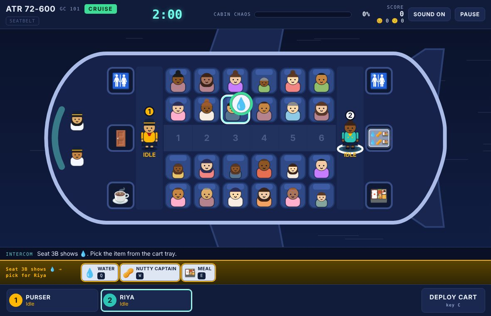
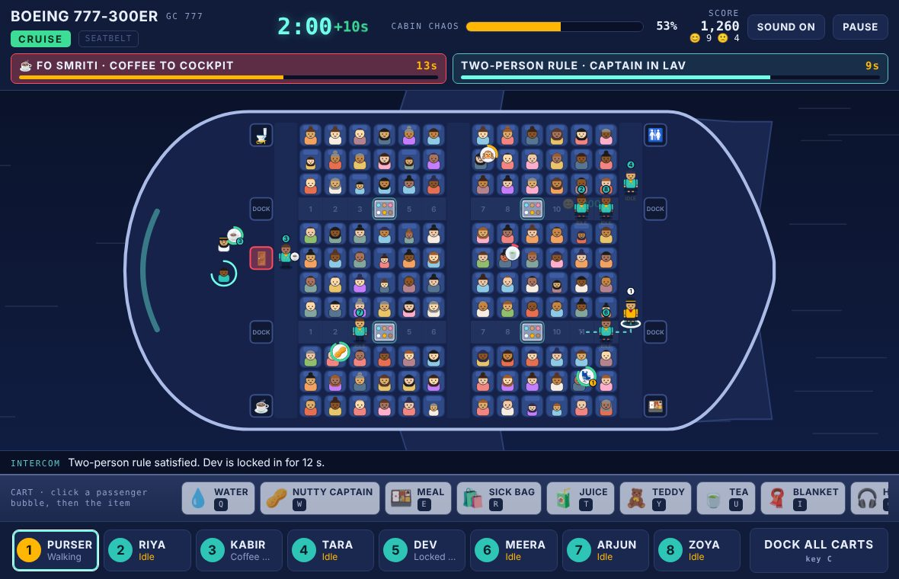
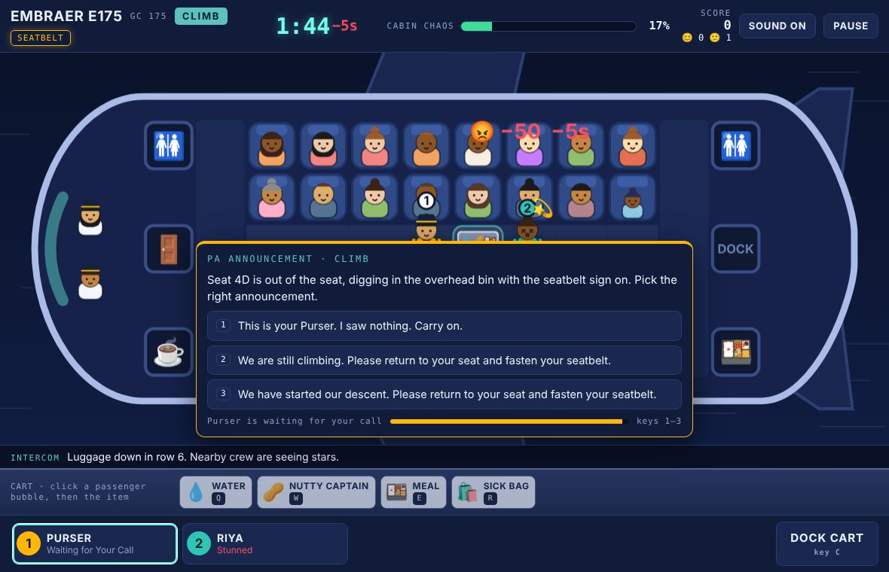
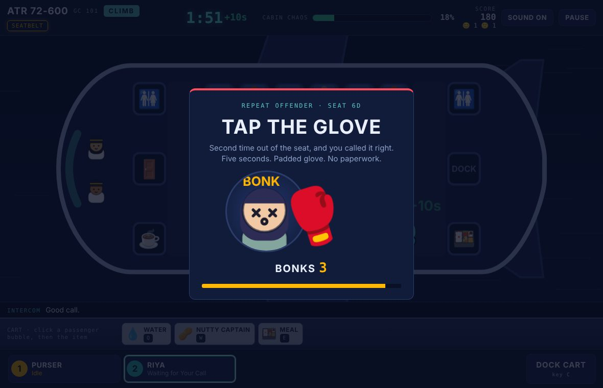
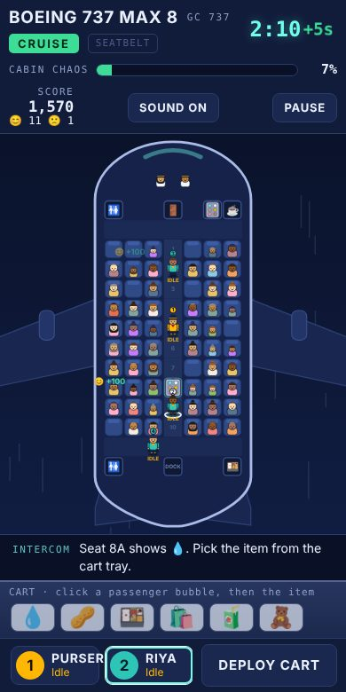

# ✈️ Galley Chaos

**You are the Purser. The seatbelt sign is on, row 14 is standing up, the toddler in 22C has found the call bell, and First Officer Smriti wants her coffee. Now.**

A free, browser-based cabin crew time-management game. No install, no ads, works offline.

### [▶ Play now](https://kunalmbhatia.github.io/galley-chaos/)

   

---

## Why this game exists

Most of us board, buckle up and switch off. We rarely see what the crew is juggling at the same time: a passenger opening an overhead bin during the climb, three call bells, a cart blocking the only aisle, a coffee run to the flight deck, and a cabin to secure before landing, all while smiling.

Galley Chaos is a light-hearted way to feel that chaos for two minutes. If it makes you a slightly kinder passenger on your next flight, it has done its job.

## How to play

1. **Select a crew member.** Click them, or press `1`–`8`.
2. **Click a passenger bubble.**
   - 💧 🥜 🍱 🧃 🍵 🍫 🧸 🛍️ 🧣 🎧 **Service:** pick the matching item from the cart tray (`Q`–`P`). The wrong item gets a frown.
   - 🧳 🧍 **Out of their seat with the sign on:** pick the correct PA announcement. Catch a repeat offender and you get five seconds with the 🥊 padded glove.
   - 😭 🦵 🔔 💺 😴 📱 **Situations:** crying babies, seat kickers, recline wars, cricket at full volume. Pick the sensible response.
3. **Never ignore the flight deck.** Coffee for FO Smriti ☕ and the two-person rule when the Captain needs a break 🚽. Let either timer run out and the flight diverts.
4. **Secure the cabin for descent.** Dock every cart within 8 seconds of turbulence and lock both lavatories.

### Scoring

| Result | Face | Points | Clock |
|---|---|---|---|
| Quick service | 😊 | Full | **+10 s** |
| On time | 🙂 | 60% | — |
| Late | 🙁 | 20% | **−5 s** |
| Wrong or missed | 😡 | Penalty | **−5 s** and Cabin Chaos |

Pick a 1, 2 or 3 minute round on the start screen. The flight lands when the clock reaches 0:00. If Cabin Chaos hits 100% first, the passengers win.

## The fleet

Crew numbers follow the regulatory minimum of one cabin crew member per 50 passenger seats (EASA ORO.CC.100 and the equivalent FAA rule). Carts scale with the crew.

| # | Aircraft | Layout | Seats | Crew | Carts | Cart items |
|---|---|---|---|---|---|---|
| 1 | ATR 72-600 | 2-2 | 72 | 2 | 1 | 3 |
| 2 | Embraer E175 | 2-2 | 88 | 2 | 1 | 4 |
| 3 | Airbus A320neo | 3-3 | 186 | 4 | 2 | 5 |
| 4 | Boeing 737 MAX 8 | 3-3 | 189 | 4 | 2 | 6 |
| 5 | Airbus A321neo | 3-3 | 232 | 5 | 2 | 7 |
| 6 | Airbus A330-300 | 2-4-2 | 300 | 6 | 3 | 8 |
| 7 | Boeing 787-9 | 3-3-3 | 296 | 6 | 3 | 9 |
| 8 | Airbus A350-900 | 3-3-3 | 325 | 7 | 3 | 10 |
| 9 | Boeing 777-300ER | 3-4-3 | 396 | 8 | 4 | 10 |

## Screenshots

| Twin-aisle chaos on the 777 | Pick the right announcement |
|---|---|
|  |  |
| **The repeat offender** | **Plays on a phone too** |
|  |  |

## Install it like an app

Open the [game](https://kunalmbhatia.github.io/galley-chaos/) in Chrome or Edge and click the install icon in the address bar, or on a phone use **Add to Home screen**. After the first visit it runs offline, which is handy at the gate.

## Tech

- Vanilla HTML5 Canvas, CSS and JavaScript. Zero dependencies, zero build step, zero image files.
- Every person, seat and cart is drawn in code. Every sound is synthesised with the Web Audio API.
- Breadth-first grid pathfinding: crew route around parked carts and switch aisles through cross-galleys on twin-aisle jets.
- Progress saves in your browser (`localStorage`).
- Anonymous play counts and optional Google sign-in run on Supabase. See the [privacy note](https://kunalmbhatia.github.io/galley-chaos/privacy.html).

| File | What it does |
|---|---|
| `index.html` | Page layout and styles |
| `game.js` | The whole game: data, simulation, drawing, input |
| `cloud.js` | Optional add-on: play counts and Google sign-in. Delete it and the game still runs |
| `sw.js` | Service worker for offline play |
| `manifest.json` | App name and icons for installing |
| `admin.html` | Private dashboard for the maintainer |
| `privacy.html` | What is collected and why |

To run it locally, download the repository and open `index.html` in a browser.

## Contribute a scenario ✍️

**Are you cabin crew, a pilot or a frequent flyer with a story?** The best scenarios come from real flights. [Suggest one here](../../issues/new?template=new-scenario.md) with the situation, the right response and two funny wrong ones. See [CONTRIBUTING.md](CONTRIBUTING.md).

## Enjoying it?

- ⭐ **Star this repository.** It is the simplest way to help other people find it.
- 💬 Tell us your high score or your favourite moment in [Issues](../../issues).
- ✈️ Share it with someone who flies for a living and ask them how realistic it is.

## Credits

Made by [Kunal Bhatia](https://github.com/kunalmbhatia), with love for the pilots and cabin crew in the family and among friends.

To every crew member who has calmed a crying child, reseated a bin rebel and still said "Welcome to your destination" with a smile: thank you. 🙏

## License

[MIT](LICENSE). Fork it, mod it, add your airline's quirks.
